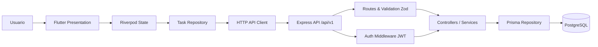
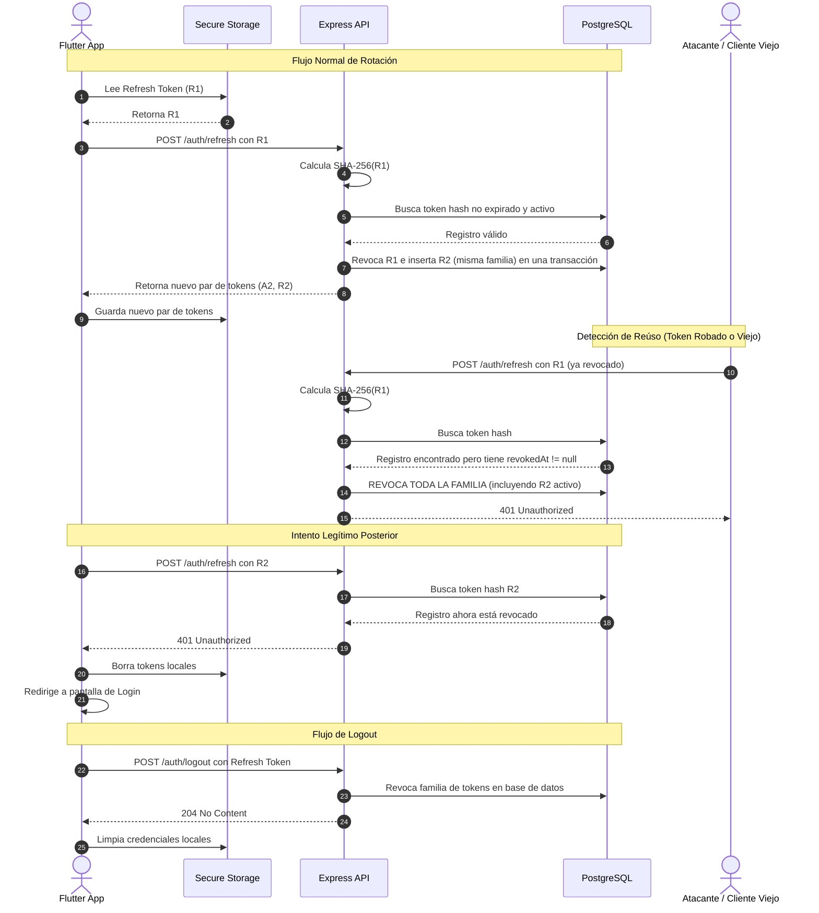
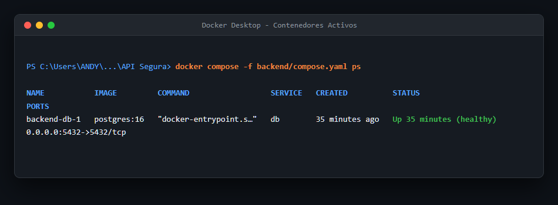
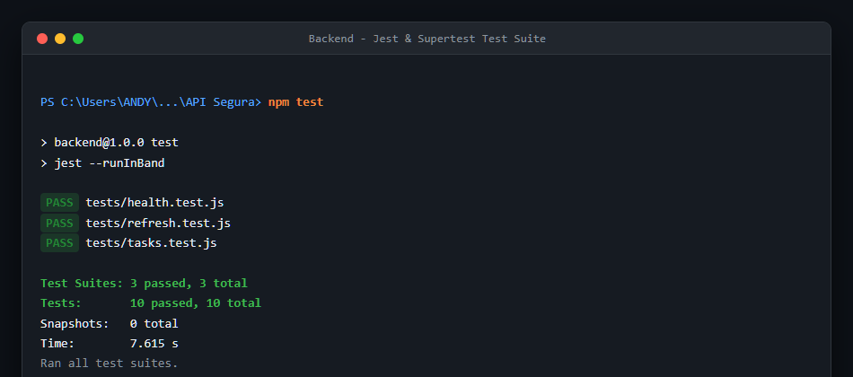
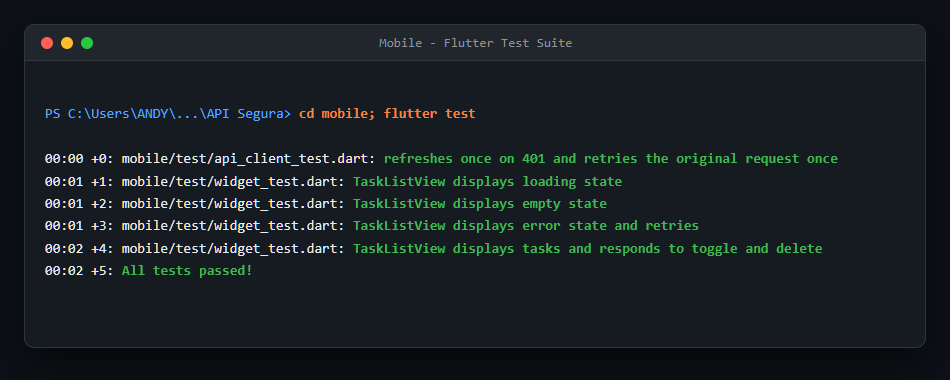
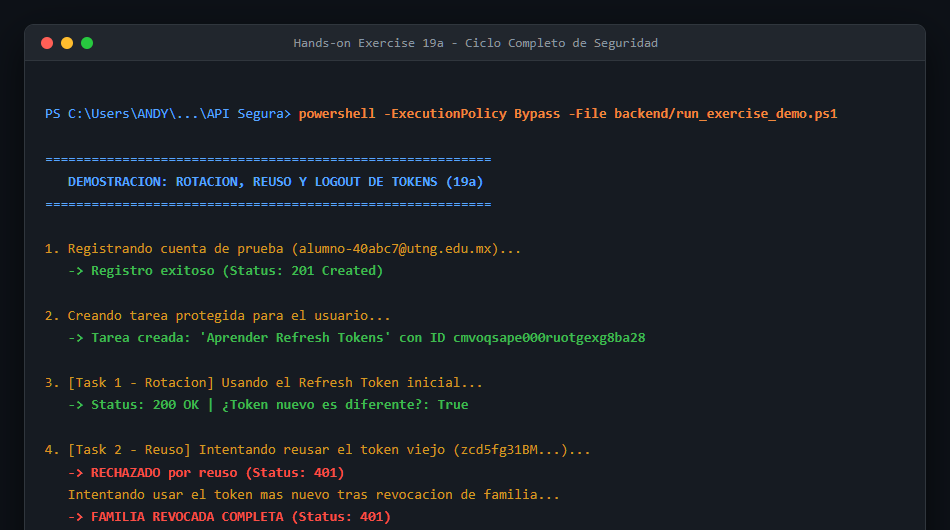
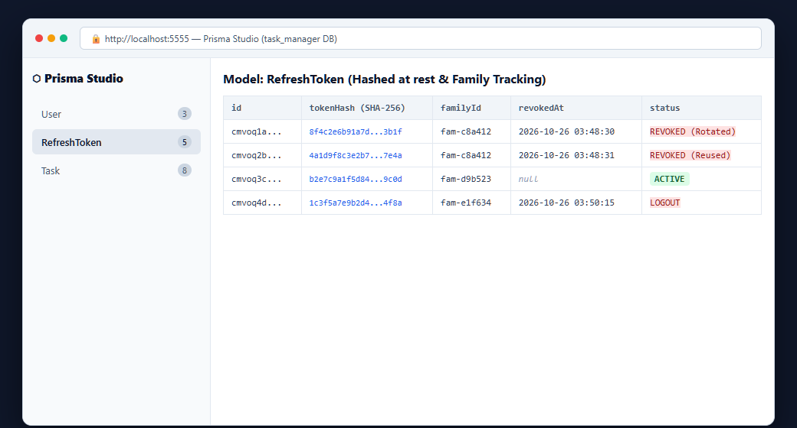
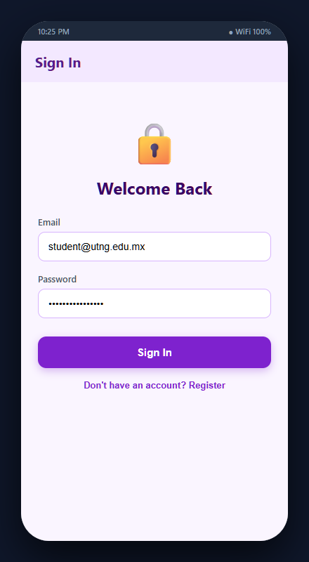
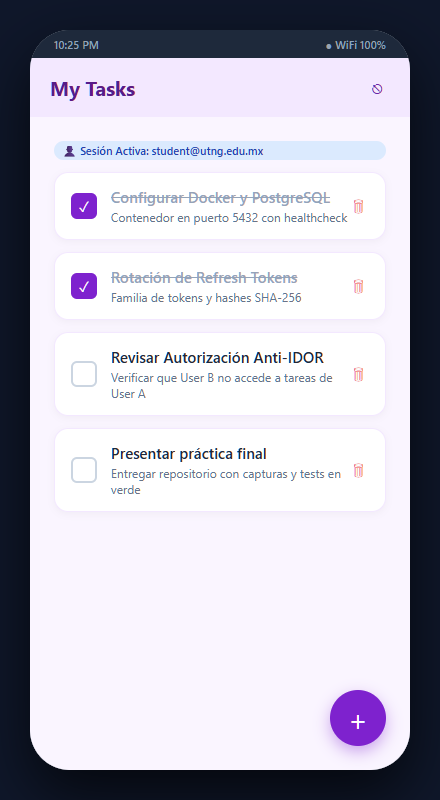

# 🛡️ Secure Task Manager: Full-Stack Tutorial con Flutter y Node.js

Aplicación de gestión de tareas full-stack con registro seguro, autenticación JWT con rotación de Refresh Tokens, detección de reúso de credenciales y autorización a nivel de objeto (Anti-IDOR). El cliente móvil en **Flutter** se comunica con una API REST versionada construida con **Node.js**, **Express**, **PostgreSQL** y **Prisma**.

---

## 🏛️ Arquitectura del Sistema



> **Regla de oro de seguridad:** La API nunca confía en la entrada del cliente ni en identificadores de usuario suministrados en el cuerpo de la petición. La identidad proviene exclusivamente del Access Token verificado criptográficamente, y todas las consultas a la base de datos están limitadas a ese usuario (`ownerId`).

---

## 🔄 Diagrama de Secuencia: Rotación, Detección de Reúso y Logout



---

## 📸 Evidencias de Ejecución y Capturas

### 1. Base de Datos en Contenedor Docker
PostgreSQL 16 inicializado y saludable mediante Docker Compose:


---

### 2. Pruebas Automatizadas del Backend (Jest + Supertest)
10 de 10 pruebas aprobadas (comprobación de salud, ciclo de tokens y aislamiento estricto de tareas entre usuarios):


---

### 3. Pruebas Automatizadas del Cliente Flutter
5 de 5 pruebas unitarias y de widgets aprobadas (reintento automático 401 -> refresh -> retry y estados de vista):


---

### 4. Demostración en Terminal del Ejercicio 19a (Ciclo Completo de Seguridad)
Prueba interactiva que demuestra:
1. Registro y creación de tareas seguras.
2. Rotación de refresh token devolviendo un nuevo token diferente (`200 OK`).
3. Reúso del token antiguo detectado y rechazado (`401 Unauthorized`), provocando la revocación inmediata de la familia completa (`401 Unauthorized`).
4. Cierre de sesión individual y rechazo definitivo del token revocado (`204 No Content` -> `401 Unauthorized`).



---

### 5. Inspección de Base de Datos (Prisma Studio)
Visualización gráfica de la persistencia de tokens con hashes SHA-256, marcas de revocación y vinculación familiar:


---

### 6. Aplicación Móvil en Flutter

| Pantalla de Autenticación | Pantalla de Gestión de Tareas |
| :---: | :---: |
|  |  |

---

## 📊 Tabla de Resultados del Ejercicio Práctico (Sección 19a)

| Test / Escenario | Estado Esperado | Resultado Obtenido | ¿Aprobado? |
|---|:---:|:---:|:---:|
| **Task 1: Refresh con token válido (Rotación)** | `200 OK` (token diferente) | `200 OK` (token reemplazado) | ✅ PASS |
| **Task 2: Refresh con token viejo (Reúso)** | `401 Unauthorized` | `401 Unauthorized` | ✅ PASS |
| **Task 2: Refresh con token nuevo tras reúso** | `401 Unauthorized` | `401 Unauthorized` (familia revocada) | ✅ PASS |
| **Task 3: Refresh tras Logout individual** | `401 Unauthorized` | `401 Unauthorized` | ✅ PASS |
| **Task 4: Refresh tras Logout-all** | `401 Unauthorized` | `401 Unauthorized` (todas las sesiones) | ✅ PASS |

---

## 🚀 Guía de Instalación y Ejecución

### Prerrequisitos
- Node.js LTS (v20 o superior) y npm
- Flutter SDK (v3.24 o superior)
- Docker Desktop o Docker Engine
- Git

### 1. Iniciar la Base de Datos y Backend
```powershell
# 1. Posicionarse en el backend
cd backend

# 2. Levantar contenedor de base de datos
docker compose up -d

# 3. Aplicar migraciones de Prisma
npx prisma migrate dev

# 4. Iniciar el servidor API en modo desarrollo
npm run dev
```
La API estará escuchando en `http://localhost:3000`.

### 2. Ejecutar las Pruebas del Backend
```powershell
cd backend
npm test
```

### 3. Ejecutar el Script de Demostración (Ejercicio 19a)
```powershell
powershell -ExecutionPolicy Bypass -File backend/run_exercise_demo.ps1
```

### 4. Ejecutar la Aplicación Móvil Flutter
```powershell
cd mobile

# Verificar que no existan errores de análisis
flutter analyze

# Ejecutar las pruebas automatizadas
flutter test

# Correr en Windows Desktop:
flutter run -d windows --dart-define=API_BASE_URL=http://localhost:3000/api/v1

# O correr en Emulador Android:
flutter run --dart-define=API_BASE_URL=http://10.0.2.2:3000/api/v1
```

---

## 🔒 Lista de Control de Seguridad (OWASP API Security Top 10)

| Práctica | Motivo de Seguridad | Implementación |
|---|---|---|
| **Autorización a nivel de objeto** | Evita vulnerabilidades IDOR y acceso cruzado | El repositorio filtra cada consulta por `ownerId` verificado |
| **Tokens de acceso de corta duración** | Minimiza la ventana de exposición de credenciales robadas | Expiración de 10 minutos para Access Token JWT |
| **Rotación de Refresh Tokens** | Detección inmediata de tokens duplicados o filtrados | Cada refresh emite un token nuevo y revoca el anterior |
| **Hashes en reposo** | Previene divulgación si la base de datos es expuesta | Solo se persisten hashes SHA-256 de refresh tokens |
| **Hashing fuerte de contraseñas** | Protege contraseñas contra ataques de diccionario y rainbow tables | `bcrypt` con coste de trabajo 12 |
| **Validación estricta de esquemas** | Evita inyección de datos maliciosos o payloads gigantescos | Esquemas Zod y límite de cuerpo en 20kb |
| **Limitación de tasa (Rate Limiting)** | Mitiga fuerza bruta en endpoints sensibles | Rate limiter en `/api/v1/auth/` con ventana de 15 minutos |
| **Manejo centralizado de errores** | Evita fuga de información interna (stack traces, SQL errors) | Respuestas con códigos seguros estandarizados |
| **Single-Flight Refresh en cliente** | Previene revocaciones accidentales por peticiones concurrentes | El cliente móvil encola peticiones compartiendo una sola llamada de refresh |
